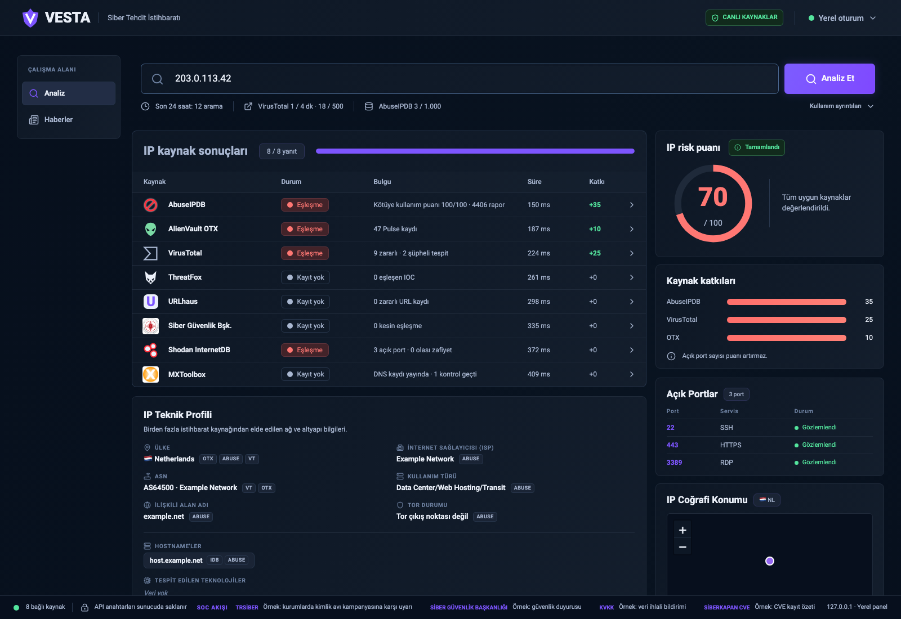
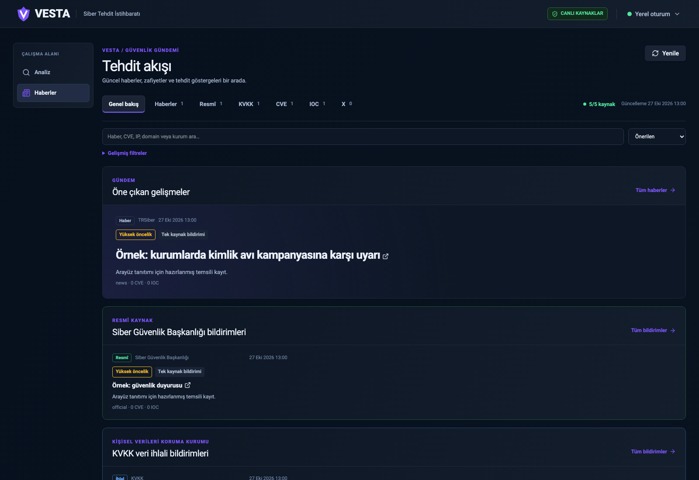
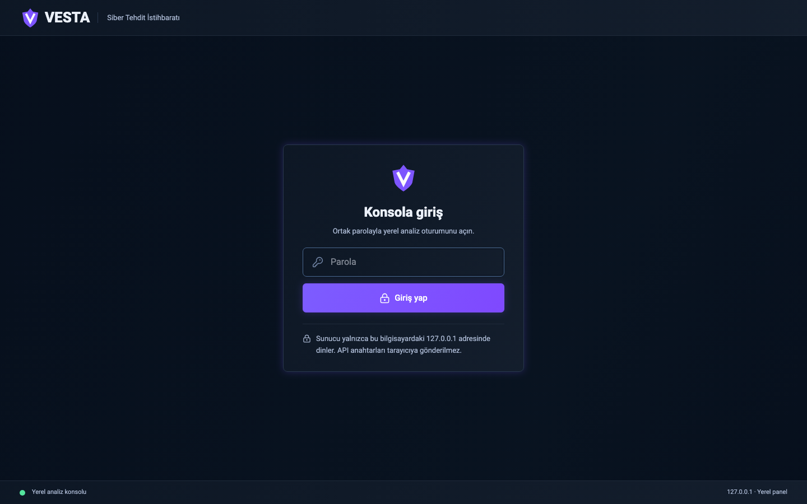
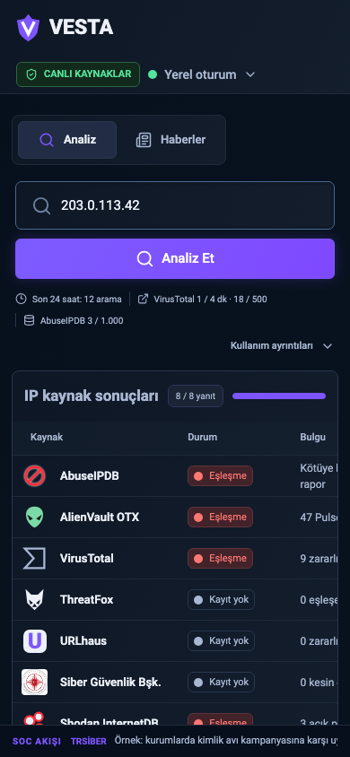

# VESTA

### Bir IP adresinin veya alan adının hikâyesini tek ekranda görün.

VESTA, şüpheli bir IP adresini veya alan adını araştırırken farklı sekmeler arasında kaybolmamanız için hazırlanmış, **Türkçe ve kendi ortamınızda çalışan bir siber tehdit istihbaratı panelidir**. Bir göstergeyi girin; yapılandırılmış kaynakların bulguları geldikçe ekranda belirsin. Ardından risk puanını, puanın hangi kaynaklardan geldiğini ve teknik ayrıntıları birlikte değerlendirin.

**Kimler için?** SOC analistleri, sistem yöneticileri, olay müdahale ekipleri ve bir adresin neden dikkat çektiğini hızlıca anlamak isteyen herkes.

## Tek panelde neler var?

| Analiz | Güvenlik gündemi |
| --- | --- |
| IP ve alan adı sorgusu; uygun kaynaklardan eşzamanlı sonuç | RSS ve resmî duyurulardan haber akışı |
| Kaynak katkıları görülebilen 0–100 risk puanı | Haber, CVE ve IOC araması ile filtreler |
| Açık portlar, olası zafiyetler ve IP teknik profili | NVD yayın tarihi ve CISA KEV bilgisiyle CVE Radar |
| Yaklaşık IP konum haritası ve kaynaklar arası ülke farkları | Haberdeki uygun göstergeden analiz ekranına geçiş |

Sonuçlar kaynak kaynak güncellenir; yavaş yanıt veren bir servis diğerlerini bekletmez. Masaüstü ve mobil görünüm ile açık ve koyu tema desteklenir.

## Önizleme

Görseller **temsili API yanıtlarıyla** üretildi; gerçek sorgu, API anahtarı veya oturum bilgisi içermez. Analiz ekranındaki `203.0.113.42` belgeleme için ayrılmış bir IP adresidir; gösterilen risk puanı ve haber başlıkları gerçek istihbarat verisi değildir.

<table>
  <tr><th>IP analizi</th><th>Haber akışı</th></tr>
  <tr>
    <td><a href="docs/screenshots/analiz.png"></a></td>
    <td><a href="docs/screenshots/haberler.png"></a></td>
  </tr>
</table>

<details>
  <summary>Giriş ve mobil görünüm</summary>
  <table>
    <tr>
      <td><a href="docs/screenshots/giris.png"></a></td>
      <td><a href="docs/screenshots/mobil.png"></a></td>
    </tr>
  </table>
</details>

## Nasıl kullanılır?

1. VESTA adresini açıp kurulum sırasında belirlenen ortak parolayla giriş yapın.
2. **Analiz** ekranına genel bir IP adresi veya alan adı yazın ve **Analiz Et** düğmesine basın.
3. Gelen kaynak sonuçlarını, kısa bulguları ve ayrıntıları inceleyin. **Haberler** ekranından güncel kayıtları takip edin; uygun bir göstergeye tıklayarak analiz ekranına taşıyın.

Panel, eşleşme, kayıt yok, desteklenmiyor, kota doldu ve hata durumlarını ayrı gösterir. **Risk puanı araştırma önceliği içindir; tek başına güvenlik kararı değildir.** Kayıt bulunmaması da adresin güvenli olduğunu kanıtlamaz. Açık portlar Shodan InternetDB'nin önceki gözlemleridir; VESTA canlı port taraması yapmaz. Haritadaki ülke merkezi IP'nin kesin fiziksel konumu değildir.

## Veri kaynakları

Analiz ekranı **AbuseIPDB, AlienVault OTX, VirusTotal, ThreatFox, URLhaus, T.C. Siber Güvenlik Başkanlığı, Shodan InternetDB ve MXToolbox** ile çalışır. Her kaynak yalnızca desteklediği gösterge türünde sorgulanır. Bazı servisler kendi API anahtarınızı gerektirir; yapılandırılmamış, yanıt vermeyen veya kotası dolan kaynaklar arayüzde açıkça belirtilir.

Haberler ekranı RSS ve resmî bildirimleri toplar; isteğe bağlı yerel X kayıtlarını da gösterebilir. Aynı olaya ilişkin kayıtlar gruplanır. Haber önceliği ve doğrulama durumu ayrı gösterilir; haber puanı olayın gerçekleşme olasılığı değildir.

## Kendi bilgisayarınızda kurulum

**Gerekenler:** Python 3.10 veya üzeri, Node.js ve npm. Kaynakları kullanmak için ilgili servislerde kendi API erişiminiz olmalıdır. Bu depo gerçek anahtar, parola, sertifika veya derlenmiş arayüz içermez.

```sh
git clone https://github.com/tolga-sparkles/VESTA.git
cd VESTA
python3 -m venv .venv
.venv/bin/pip install -r requirements.txt
cp .env.example .env
chmod 600 .env
```

`.env` dosyasına kullanacağınız servislerin anahtarlarını ekleyin. Ortak giriş parolası için Argon2id özeti ve oturumlar için rastgele bir gizli değer oluşturup çıktıları sırasıyla `APP_PASSWORD_HASH` ve `SESSION_SECRET` alanlarına yazın:

```sh
.venv/bin/python -c 'from getpass import getpass; from argon2 import PasswordHasher; print(PasswordHasher().hash(getpass("VESTA parolası: ")))'
.venv/bin/python -c 'import secrets; print(secrets.token_hex(32))'
```

Parolanızı güvenli bir yerde saklayın. Ardından uygulamayı başlatın:

```sh
./run.sh
```

Tarayıcıda **http://127.0.0.1:8000** adresini açın. `run.sh` arayüz bağımlılıklarını gerektiğinde kurup derler; sunucu yalnızca bu bilgisayarda dinler. Kapatmak için Terminal'de **Ctrl+C** kullanın. Yerel ağda kullanmak için HTTPS kurulumu gerekir; örnek `Caddyfile` ve `run-https.sh` depoda bulunur.

## Gizlilik ve kullanım sınırları

- API anahtarları sunucudaki `.env` dosyasında kalır; tarayıcıya gönderilmez. Giriş, parolanın Argon2id özetiyle doğrulanır.
- Arama geçmişi tutulmaz. Yerel kullanım sayaçları yalnızca istek zamanlarını ve kaynak adlarını kaydeder. Sorguladığınız IP veya alan adı, sonuç almak için ilgili üçüncü taraf servislere gönderilir.
- Yalnızca genel IPv4/IPv6 adresleri ve geçerli alan adları kabul edilir. Yerel/özel IP adresleri ve URL'ler reddedilir; dosya yüklenmez.
- Uygulama, VirusTotal isteklerini ortak **4/dakika ve 500/24 saat** yerel kotasıyla sınırlar. Gerçek servis koşulları ve hesap kotanız farklı olabilir.

Teknik çalışma mantığı, risk puanı kuralları ve kaynak bazlı ayrıntılar için [Yazılım Açıklaması](YAZILIM-ACIKLAMASI.md) dosyasına bakın.

<details>
  <summary>Geliştirici komutları</summary>

  ```sh
  .venv/bin/python -m unittest discover -s tests -v
  cd web
  npm test
  npm run lint
  npm run build
  ```

</details>
